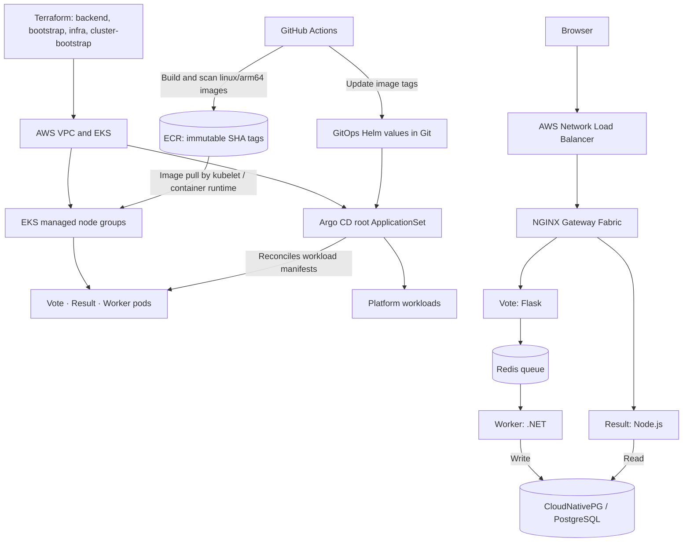

# Voting App on AWS EKS

A multi-service voting application deployed to Amazon EKS with Terraform, GitHub Actions and Argo CD. Terraform provisions the AWS foundation and bootstraps the cluster; GitHub Actions builds and publishes the application images; Argo CD deploys the platform services and application from Git.

The application is intentionally small. The project focuses on the infrastructure and delivery workflow around it: EKS networking and identity, container publishing, GitOps, Gateway API routing, managed PostgreSQL operations and supporting Kubernetes services.

## Architecture



- Terraform creates the VPC, EKS cluster, managed node groups, ECR repositories, IAM roles, Pod Identity associations and database credentials in AWS Secrets Manager.
- GitHub Actions builds the changed application images for `linux/arm64`, scans them and publishes immutable Git-SHA tags to ECR. It then updates the corresponding image tags in `gitops/voting-app/values.yaml`.
- Argo CD watches the `main` branch and reconciles the platform and application Helm charts from Git. It applies the workload definitions and image references; the EKS nodes pull the referenced container images from ECR when required.
- NGINX Gateway Fabric exposes the application through an AWS Network Load Balancer. Gateway API `HTTPRoute` resources route `vote` and `result` hostnames to their Services; HTTP is redirected to HTTPS.

## Application components

| Component | Technology | Responsibility |
|---|---|---|
| Vote | Python / Flask | Accepts votes and places them on the Redis queue |
| Redis | Redis | Buffers votes until the worker processes them |
| Worker | C# / .NET 10 | Consumes queued votes and writes them to PostgreSQL |
| PostgreSQL | CloudNativePG | Stores votes in a two-instance PostgreSQL cluster |
| Result | Node.js / Express / Socket.IO | Reads vote totals and publishes live result updates |

The voting mode is configured in `gitops/voting-app/values.yaml`. The default is `one-per-voter`; `every-click` is also supported.

## AWS and Kubernetes platform

| Area | Implementation |
|---|---|
| Network | VPC with public and private subnets across two Availability Zones, NAT Gateway and an S3 gateway endpoint |
| Kubernetes | EKS 1.37 by default, with managed node groups in private subnets |
| Node architecture | ARM64 by default (`t4g.medium`); ARM64 tends to be cheaper, keep instances with adequate resources to avoid hard to track resource-related failures; the CI image build also targets ARM64 |
| Storage | EBS CSI driver and encrypted `gp3` StorageClass |
| Workload identity | EKS Pod Identity for AWS-integrated controllers and the EBS CSI driver |
| Container registry | Three ECR repositories: `vote`, `result` and `worker`; immutable tags and image scan on push |
| Database credentials | Generated by Terraform, stored in AWS Secrets Manager and synchronised into Kubernetes by External Secrets Operator |
| Ingress and DNS | NGINX Gateway Fabric, Gateway API, AWS Load Balancer Controller, ExternalDNS and Route 53 |
| TLS | cert-manager with Let's Encrypt DNS-01 validation through Route 53 |
| Database operator | CloudNativePG |
| Cluster UI | Argo CD and Headlamp |

The platform is installed through three Argo CD child Applications created by the root ApplicationSet:

- `platform-infra`: NGINX Gateway Fabric, AWS Load Balancer Controller, External Secrets Operator, cert-manager, ExternalDNS, CloudNativePG and Headlamp.
- `platform-config`: Gateway, ClusterSecretStore, `gp3` StorageClass and Headlamp viewer RBAC.
- `voting-app`: application Deployments and Services, Redis, the CloudNativePG Cluster, ExternalSecret, PodDisruptionBudgets and HTTPRoutes.

Argo CD automated sync, pruning and self-healing are enabled for these Applications.

## Platform components and their roles

| Component | Role in this project |
|---|---|
| NGINX Gateway Fabric | Implements the Kubernetes Gateway API and routes external HTTP traffic to the application Services using `Gateway` and `HTTPRoute` resources. |
| AWS Load Balancer Controller | Integrates the Gateway's `LoadBalancer` Service with AWS and provisions the Network Load Balancer. |
| ExternalDNS | Watches Gateway API `HTTPRoute` resources and creates or updates the corresponding public DNS records in Route 53. DNS stays aligned with the application routes defined in Git. |
| cert-manager | Automates TLS certificate issuance and renewal. The Gateway uses Let's Encrypt `ClusterIssuer` resources with DNS-01 validation through Route 53. Both staging and production issuers are configured. |
| External Secrets Operator | Watches `ExternalSecret` resources, retrieves values from AWS Secrets Manager and synchronises them into Kubernetes Secrets. Here it keeps the PostgreSQL application credentials available inside the cluster. |
| ClusterSecretStore | Defines the cluster-wide connection to AWS Secrets Manager, including the provider and region. It is a reusable reference for `ExternalSecret` resources; it does not contain the secret values itself. |
| ExternalSecret | Defines which remote secret properties to retrieve and which Kubernetes Secret to create. Here it maps the database username and password into `postgres-app-credentials`. |
| CloudNativePG | PostgreSQL operator that manages the database cluster inside Kubernetes, including its instances, replication and database services. The worker writes through `postgres-rw`, while the result service reads through `postgres-r`. |
| EBS CSI Driver and `gp3` StorageClass | The EBS CSI driver provisions persistent AWS EBS volumes dynamically. The default `gp3` StorageClass provides encrypted, expandable general-purpose SSD storage; CloudNativePG uses it for the PostgreSQL data volumes. |
| EKS Pod Identity | Associates IAM roles with Kubernetes service accounts, allowing controllers such as External Secrets, ExternalDNS, cert-manager and EBS CSI to access the required AWS APIs without static AWS credentials in their pods. |

## CI/CD workflows

| Workflow | Trigger | Purpose |
|---|---|---|
| `CI Build, Scan & Push` | PR and push to `main` (GitOps-only changes are ignored); manual | Detects changed service paths, builds ARM64 images, runs scans, pushes images to ECR on `main` and updates GitOps image tags |
| `Terraform plan and apply` | Terraform changes on PR/push to `main`; manual; weekly schedule | Validates and plans Terraform, applies `infra` and `cluster-bootstrap`, and checks for infrastructure drift |
| `Voting app chart validation` | PR/push affecting `gitops/**`; manual | Runs Helm lint/render, Kubernetes schema validation with kubeconform and a Trivy configuration scan |
| `Destroy EKS environment` | Manual dispatch | Removes application and platform resources, then destroys `cluster-bootstrap` and `infra` after confirmation and environment approval |

### Image delivery

The workflow runs for repository changes except GitOps-only changes, but builds only services with changed files under `vote/`, `result/` or `worker/`. Pull requests build and scan but do not publish to ECR. A push to `main` publishes the images with the full Git commit SHA as the immutable tag and updates only the affected service tags in `gitops/voting-app/values.yaml`.

For a first deployment, after the ECR repositories have been created, run `CI Build, Scan & Push` manually from `main` with `force_build_all: true`. This publishes all three images before the application is reconciled by Argo CD. The image-tag update uses `TAG_BOT_PAT` to commit the changed Helm values.

Changes under `gitops/` are excluded from the image build workflow; those changes are checked by `Voting app chart validation` and then reconciled by Argo CD.

### Terraform automation

- Pull requests run Terraform formatting, validation, TFLint and an infrastructure plan. The plan workflow also contains a cluster-bootstrap plan, which depends on outputs from the already-created `infra` state.
- A push to `main` affecting `terraform/infra/**`, `terraform/cluster-bootstrap/**` or `terraform/backend.conf` starts the apply workflow. The `infra-apply` GitHub Environment protects the apply job.
- The apply job provisions `infra`, performs a first targeted apply of the Argo CD Helm release, then applies the complete `cluster-bootstrap` stack.
- A scheduled check runs every Monday at 06:17 UTC. It plans the existing stacks and creates or updates a GitHub issue when drift is detected.
- The `Destroy EKS environment` workflow requires the exact cluster name as a manual confirmation and uses the `infra-destroy` environment.


## Prerequisites

- An AWS account with permission to create the resources defined in the Terraform stacks.
- An existing public Route 53 hosted zone. The project creates records inside that zone; it does not register a domain or create the hosted zone.
- Terraform CLI 1.16.0 or later, AWS CLI, Git and access to the GitHub repository.
- `kubectl` for cluster access. Helm 3 and kubeconform are used by the chart validation workflow.
- A GitHub Actions configuration with the variables, secrets and environments listed below.

The EKS public API endpoint is enabled so GitHub-hosted runners can reach it. Its default allowed CIDR is `0.0.0.0/0`; see [Main limitations](#main-limitations) before using this outside a learning environment.

## Configure GitHub Actions

The workflows use the following exact repository variable names.

| Repository variable | Purpose |
|---|---|
| `AWS_REGION` | AWS deployment region |
| `UNIQUE_ID` | Resource name prefix; defaults to `dvd` in Terraform |
| `ENV_TAG` | Environment suffix; defaults to `dev` |
| `ZONE_NAME` | Existing Route 53 hosted zone name |
| `SUBDOMAIN` | Application subdomain below `ZONE_NAME` |
| `ACME_EMAIL` | Let's Encrypt account email |
| `ACME_ISSUER` | `letsencrypt-staging` or `letsencrypt-prod` |
| `SONAR_ORGANIZATION` | SonarCloud organisation key |
| `SONAR_PROJECT_KEY` | SonarCloud project key |

Configure these repository secrets:

| Repository secret | Purpose |
|---|---|
| `AWS_ROLE_TF_PLAN` | ARN from the `tf_plan_role_arn` Terraform output |
| `AWS_ROLE_ECR_PUSH` | ARN from the `ecr_push_role_arn` Terraform output |
| `SONAR_TOKEN` | SonarCloud authentication token |
| `TAG_BOT_PAT` | GitHub token with permission to commit the updated image tags to `main` |
| `ADDITIONAL_CLUSTER_ADMINS` | Optional JSON array of IAM principal ARNs to grant EKS cluster-admin access |

Configure `AWS_ROLE_TF_APPLY` as an environment secret in **both** GitHub Environments:

- `infra-apply`
- `infra-destroy`

Use the `tf_apply_role_arn` Terraform output for both. Configure required reviewers on these environments if manual approval is required before infrastructure changes or destruction.

The bootstrap Terraform stack outputs `tf_plan_role_arn`, `tf_apply_role_arn`, `ecr_push_role_arn` and `ecr_repository_urls`. The workflows consume the three role ARNs using the secret names above. They construct ECR repository names from `UNIQUE_ID`, `ENV_TAG` and the service name; they do not consume an `ECR_REPOSITORIES` Actions variable.

GitHub Actions authenticates to AWS using OIDC. Do not add long-lived AWS access keys to repository secrets.

## Provision the infrastructure

The Terraform setup is split into four stacks. The `backend` stack creates the S3 bucket used by the other stacks; `bootstrap` creates ECR and GitHub OIDC roles; `infra` creates the AWS network and EKS cluster; `cluster-bootstrap` installs Argo CD and creates the root ApplicationSet.

### 1. Create the Terraform state bucket

The backend stack is initialised locally and uses local Terraform state. Set `aws_region` and `unique_id` in a local `terraform.tfvars` file under `terraform/backend/`, or provide equivalent `TF_VAR_` environment variables.

```bash
terraform -chdir=terraform/backend init
terraform -chdir=terraform/backend validate
terraform -chdir=terraform/backend plan
terraform -chdir=terraform/backend apply
```

The bucket is named `ironhack-project-2-state-<UNIQUE_ID>`. It has versioning, AES-256 server-side encryption and S3 Block Public Access enabled.

### 2. Configure the remote backend

Update `terraform/backend.conf` to match the bucket and region created in the previous step:

```hcl
bucket       = "ironhack-project-2-state-<UNIQUE_ID>"
region       = "<AWS_REGION>"
use_lockfile = true
```

The remote state keys are defined in the stack backend files:

| Stack | S3 state key |
|---|---|
| `bootstrap` | `bootstrap/terraform.tfstate` |
| `infra` | `infra/terraform.tfstate` |
| `cluster-bootstrap` | `cluster-bootstrap/terraform.tfstate` |

### 3. Run the bootstrap stack

Create a local `terraform.tfvars` under `terraform/bootstrap/` (or set the equivalent `TF_VAR_` variables). At minimum, the values must match the backend configuration and identify an existing Route 53 hosted zone:

```hcl
aws_region = "<AWS_REGION>"
unique_id  = "<UNIQUE_ID>"
env_tag    = "<ENV_TAG>"
zone_name  = "<EXISTING_ZONE_NAME>"
```

By default, `manage_oidc_provider` is `false`, so the stack looks up an existing GitHub Actions OIDC provider in the AWS account. Set `manage_oidc_provider = true` when the account does not already have that provider and this stack should create it.

```bash
terraform -chdir=terraform/bootstrap init -backend-config=../backend.conf
terraform -chdir=terraform/bootstrap validate
terraform -chdir=terraform/bootstrap plan
terraform -chdir=terraform/bootstrap apply
terraform -chdir=terraform/bootstrap output
```

The bootstrap stack creates three ECR repositories, immutable image tag policies, the GitHub OIDC trust and the Terraform plan, Terraform apply and ECR push roles. Copy the role ARNs into the GitHub secrets described above.

### 4. Build and publish the application images

After the ECR repositories and `AWS_ROLE_ECR_PUSH` secret exist, run `CI Build, Scan & Push` from the `main` branch with `force_build_all: true`. Confirm that all three images are present in ECR and that the workflow has committed their SHA tags to `gitops/voting-app/values.yaml`.

### 5. Apply the EKS infrastructure and cluster bootstrap

Run `Terraform plan and apply` from GitHub Actions with `action: apply`. Approve the `infra-apply` Environment when prompted. The workflow applies the stacks in this order:

1. `terraform/infra`: VPC, EKS, managed node groups, Pod Identity roles/associations and the PostgreSQL secret.
2. `terraform/cluster-bootstrap`: first installs the Argo CD Helm release, then applies the full stack to register the in-cluster destination and create the root ApplicationSet.

Argo CD then discovers the `gitops/argocd` chart and creates the `platform-infra`, `platform-config` and `voting-app` Applications. These Applications track `main` and reconcile automatically.

For an initial deployment, the workflow's `plan` action is not a complete preflight for both stacks: the `cluster-bootstrap` provider uses the EKS endpoint and certificate from the `infra` remote-state outputs, which do not exist before the first infrastructure apply. An infra-only plan can be run locally before the first apply. Once the infra state exists, the workflow's plan action can plan both stacks.

## Access the cluster and application

Configure `kubectl` for the cluster:

```bash
aws eks update-kubeconfig \
  --region <AWS_REGION> \
  --name <UNIQUE_ID>-<ENV_TAG>-cluster

kubectl get nodes
kubectl get applications -n argocd
```

The application hostnames are derived from `SUBDOMAIN` and `ZONE_NAME`:

- Vote: `https://vote.<SUBDOMAIN>.<ZONE_NAME>`
- Results: `https://result.<SUBDOMAIN>.<ZONE_NAME>`

ExternalDNS creates the Route 53 records from the Gateway API routes. cert-manager obtains the wildcard certificate using DNS-01 validation. `ACME_ISSUER` defaults to `letsencrypt-staging`; staging certificates are not trusted by normal browsers. Use `letsencrypt-prod` when a publicly trusted certificate is required.

### Argo CD dashboard

```bash
kubectl -n argocd get secret argocd-initial-admin-secret \
  -o jsonpath="{.data.password}" | base64 -d
 echo
kubectl port-forward -n argocd svc/argocd-server 8080:443
```

Open `https://localhost:8080` and sign in with user `admin` and the retrieved password.

### Headlamp dashboard

```bash
kubectl create token headlamp-viewer -n platform-infra --duration=1h
kubectl port-forward -n kube-system service/platform-infra-headlamp 8081:80
```

Open `https://localhost:8081` and authenticate with the token. The `headlamp-viewer` service account is bound to the Kubernetes `view` ClusterRole.


## Repository layout

| Path | Purpose |
|---|---|
| `.github/workflows/` | Application CI, Terraform automation, chart validation and teardown |
| `terraform/backend/` | One-time S3 state bucket provisioning using local state |
| `terraform/bootstrap/` | ECR repositories, GitHub OIDC and CI/Terraform IAM roles |
| `terraform/infra/` | VPC, EKS, node groups, Pod Identity, IAM and Secrets Manager |
| `terraform/cluster-bootstrap/` | Argo CD installation and root ApplicationSet |
| `gitops/argocd/` | Root Helm chart that creates the child Argo CD Applications |
| `gitops/platform-infra/` | Platform controllers and operators |
| `gitops/platform-config/` | Gateway, storage, ClusterSecretStore and cluster configuration |
| `gitops/voting-app/` | Application Helm chart and workload configuration |
| `vote/` | Flask voting frontend |
| `worker/` | .NET vote-processing worker |
| `result/` | Node.js results frontend and Socket.IO updates |

## Teardown

Run `Destroy EKS environment` from GitHub Actions, enter the exact cluster name (`<UNIQUE_ID>-<ENV_TAG>-cluster`) and approve the `infra-destroy` Environment.

The workflow removes the Argo CD applications and platform resources in dependency order, then destroys `cluster-bootstrap` and `infra`. It intentionally preserves the bootstrap stack, ECR repositories and Terraform state bucket. Removing those requires a separate, deliberate teardown of the `bootstrap` and `backend` stacks after the cluster has been destroyed.

## Main limitations

- **Redis is not durable or highly available.** The chart deploys one Redis replica with RDB snapshots and AOF disabled. Votes waiting in the queue can be lost if the Redis pod is restarted or replaced.
- **PostgreSQL replication is asynchronous.** CloudNativePG runs two instances, but the Cluster manifest does not configure synchronous replication. A failover can therefore lose transactions that had not reached the standby. The checked-in Cluster manifest also does not define a scheduled backup destination or retention policy.
- **Application scaling is static.** Vote, result and worker replica counts are configured in Helm values. There are no application HPAs or cluster autoscaler/Karpenter deployment in this repository. The EKS managed node groups have configured minimum, desired and maximum sizes, but node provisioning is not driven by workload demand automatically.
- **The EKS API endpoint is broadly exposed by default.** `endpoint_public_access_cidrs` defaults to `0.0.0.0/0` to permit GitHub-hosted runners without fixed egress addresses. Restrict this where the deployment environment allows it.
- **Security automation is not a strict release gate.** Trivy scans upload findings, but the filesystem, image and Terraform configuration scan commands use `--exit-code 0`. The Dockerfile/workflow lint job is advisory, the chart Trivy scan is non-blocking, and SonarCloud is configured with `sonar.qualitygate.wait=false`. A green workflow should not be interpreted as proof that no security findings exist.
- **Application observability is limited.** EKS control-plane API, audit and authenticator logs are enabled with seven-day retention, and metrics-server supports basic node/pod resource queries. The repository does not deploy an application metrics stack, dashboards, alerting or central application-log aggregation.
- **The application is a demonstration workload, not a performance benchmark.** There is no load-testing suite or application-level performance tuning in the repository. The local Compose stack is also intentionally simpler than the EKS deployment.
